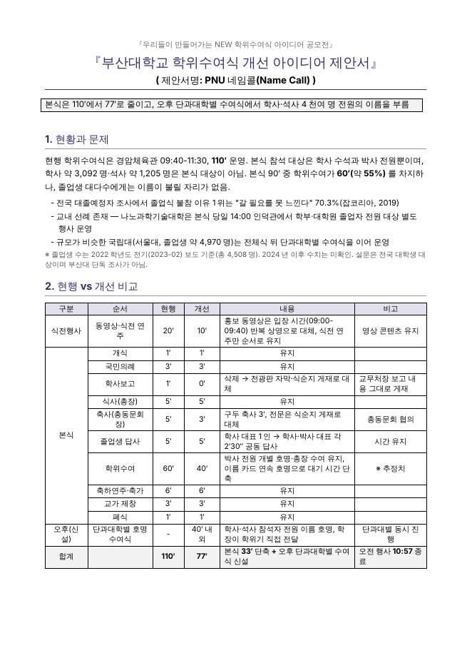
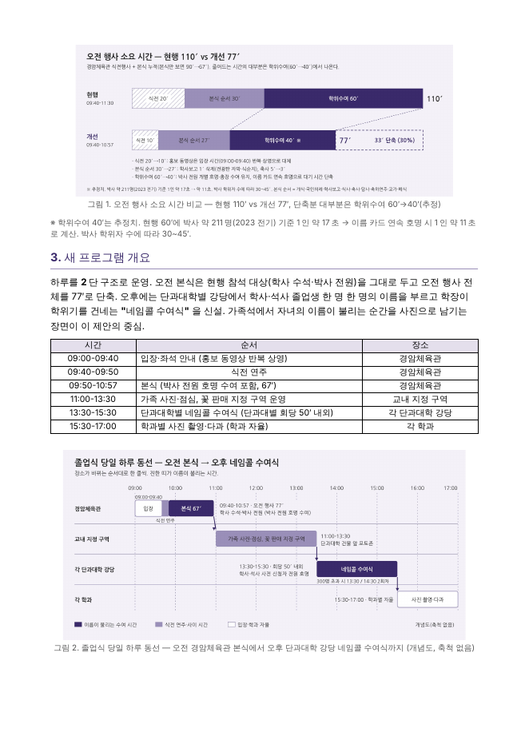
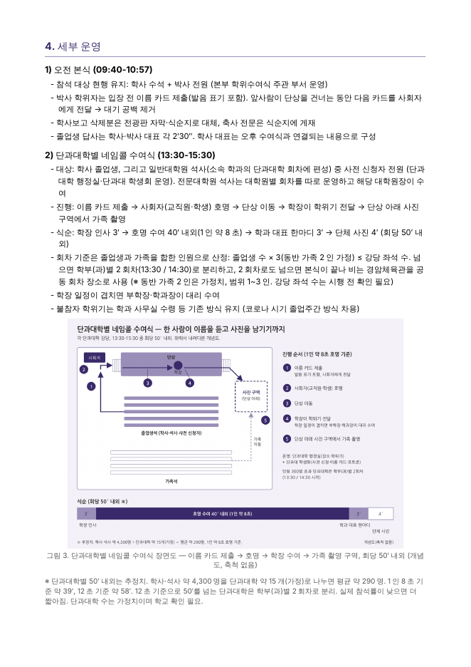
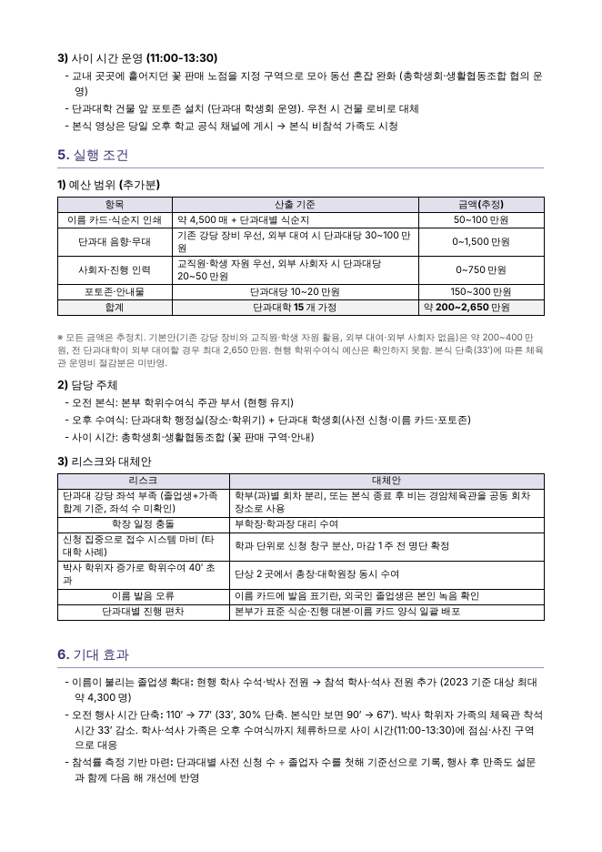

# 공모전 제안서 작성 에이전트 — 서브에이전트 + Skill

**AX혁신과 자율스터디 4회차 미션 · 문서 작성 에이전트 + 서브에이전트·Skill**

공모 주제와 현행 자료를 주면 조사부터 그림, 심사, 수정까지 거쳐 제안서 `.docx` 를 만드는 Claude Code 에이전트.

검증은 실제 공모전으로 했다. 내가 직접 써서 2026. 10. 6. 제출한 **「부산대학교 학위수여식 개선 아이디어 공모전」** 제안서와 같은 주제를 에이전트에게 주었다. 에이전트가 만든 **실제 파일**을 내 제출본과 나란히 비교한 결과가 이 4회차 제출물이다.

---

## 1. 구조

```
사용자: 공모 주제 + 현행 자료
   │
   ▼
메인 에이전트 (편집장, CLAUDE.md)
   ├─① researcher   ─ 현행 실태·비교 사례·제약 조건 조사       → research.md
   ├─② 아이디어 결정 · 초안 (Skill: contest-proposal)          → notes.md, proposal.json
   ├─③ illustrator  ─ 배치도·흐름도 SVG→PNG, 사진 프롬프트     → figures/
   ├─④ 빌드 (Skill 스크립트)                                    → out/*.docx, *.pdf, *.png
   └─⑤ judge        ─ 결과물 페이지 이미지만 보고 채점·수정 지시 → review.md  (최대 2회)
```

| 구성 요소 | 파일 | 하는 일 |
|---|---|---|
| 메인 에이전트 | [`CLAUDE.md`](CLAUDE.md) | 순서를 정하고 아이디어를 결정한다. 서브에이전트 결과를 받아 반영한다 |
| **Skill** | [`.claude/skills/contest-proposal/`](.claude/skills/contest-proposal/SKILL.md) | 제안서 **골조·문체 규칙·JSON 스키마**를 담고, docx 빌드·미리보기·SVG 렌더 스크립트를 둔다 |
| 서브에이전트 | [`researcher`](.claude/agents/researcher.md) | 사실과 출처만 모은다. 아이디어는 내지 않는다 |
| 서브에이전트 | [`illustrator`](.claude/agents/illustrator.md) | 글로 길게 설명할 것을 그림 한 장으로 바꾼다. 최대 3장 |
| 서브에이전트 | [`judge`](.claude/agents/judge.md) | 심사위원 역할이다. **작성 과정을 모른 채** 페이지 이미지만 본다 |

### 설계 결정

**Skill 에는 형식만, 판단은 에이전트에게.**
내 제출본에서 반복되는 습관을 뽑아 규칙으로 만들었다.
- "110′ → 65′" 처럼 숫자로 말한다
- 삭제하는 항목에는 반드시 대체 수단을 붙인다
- 추정치는 ※ 주석으로 범위를 밝힌다
- 막힐 수 있는 요소는 같은 자리에 대체안을 쓴다 (예: "드론 승인이 어려우면 고소 촬영")

무엇을 제안할지는 Skill 에 넣지 않았다. 넣으면 모든 주제가 같은 답으로 수렴한다.

**심사위원은 작성 맥락을 모르게 한다.**
judge 에게는 `notes.md`(왜 이렇게 썼는지)와 `proposal.json`(원문)을 주지 않고 **렌더링된 페이지 PNG** 만 준다.
- 의도를 아는 검토자는 결과물에 없는 것을 머릿속에서 채워 읽는다.
- 표가 깨졌는지, 그림이 본문과 맞는지는 이미지로만 보인다.

1차 심사가 실제로 빌더 버그(소제목이 쪽 끝에 홀로 남음, 옛 PNG 잔존)를 찾아냈고, 이 둘은 Skill 스크립트에서 고쳤다.

**이미지 생성 서브에이전트: "사진" 보다 "도면".**
Claude 는 사진을 만들지 못한다. 그런데 제안서에 정말 필요한 그림은 사진이 아니었다.
- 배치도, 시간 비교 막대, 수여 절차 장면도는 본문의 숫자·이름과 **글자 그대로 일치해야** 한다.
- 생성형 이미지 모델은 한글을 깨뜨리고 배치를 지어낸다.

그래서 illustrator 는 도면은 SVG 로 직접 그리고, 렌더링한 PNG 를 **자기가 다시 열어 보고** 겹침·잘림을 고친다. 사진풍 콘셉트 이미지는 생성 모델에 붙여 넣을 프롬프트([`image_prompt.md`](examples/graduation/figures/image_prompt.md))만 쓴다. 이 판단이 맞았다는 근거는 아래 비교의 콘셉트 이미지 항목에 있다.

**결과는 파일로, 맥락에는 요약만.**
서브에이전트는 각자 깨끗한 맥락에서 시작한다. 결과는 파일로 남기고, 메인 에이전트에는 3~5줄 요약만 돌려준다. 조사 원문 수십 건이 편집장의 판단을 흐리지 않게 하기 위해서다.

---

## 2. 실제로 돌린 결과

입력은 [`brief.md`](examples/graduation/brief.md) 다. 공고에서 알 수 있는 것과 현행 식순(110분)만 넣었다. **내 아이디어는 넣지 않았다.**

초안을 쓴 에이전트에게는 `submitted/` 폴더를 열지 못하게 했다(블라인드).

| 단계 | 산출물 | 소요 |
|---|---|---|
| ① 조사 | [`research.md`](examples/graduation/research.md) — 출처 URL 27건, "확인하지 못한 것" 9건 | 약 2분 |
| ② 아이디어·초안 | [`notes.md`](examples/graduation/notes.md), [`proposal.json`](examples/graduation/proposal.json) | 약 2.5분 |
| ③ 그림 | [`figures/`](examples/graduation/figures/) — SVG 3장 + 프롬프트 | 약 3.5분 |
| ⑤ 1차 심사 | [`review_1차.md`](examples/graduation/review_1차.md) — 19/25, 반드시 고칠 것 5건 | 약 2분 |
| ⑤ 2차 심사 | [`review_2차.md`](examples/graduation/review_2차.md) — 18/25, 반드시 고칠 것 5건 | 약 2분 |
| **최종 파일** | [`out/제안서_에이전트.docx`](examples/graduation/out/제안서_에이전트.docx) · [PDF](examples/graduation/out/제안서_에이전트.pdf) (A4 4쪽) | — |

| 1쪽 | 2쪽 | 3쪽 | 4쪽 |
|---|---|---|---|
|  |  |  |  |

---

## 3. 내 제출본 vs 에이전트 생성본

- 내 제출본: [`submitted/제안서_제출본.md`](examples/graduation/submitted/제안서_제출본.md) + [`concept.jpg`](examples/graduation/submitted/concept.jpg)
- 에이전트 생성본: 위 `out/제안서_에이전트.docx`

같은 judge 정의로 둘 다 채점했다. 제출본 채점 결과는 [`submitted/review.md`](examples/graduation/submitted/review.md) 에 있다.

### 무엇을 제안했나

| | 내 제출본 — **PNU 커먼스** | 에이전트 — **PNU 네임콜** |
|---|---|---|
| 한 줄 | 체육관 110′→65′, 대운동장 '졸업 마을'에서 학과 텐트별 전원 호명 | 오전 행사 110′→77′, 오후 단과대학 강당별로 학사·석사 전원 호명 |
| 핵심 장면 | 축제·졸업 행진·박수 터널·학위모 항공샷 | 이름 카드 → 호명 → 학장 수여 → 가족 촬영 구역 |
| 전원 호명 장소 | 대운동장 학과 텐트 (야외) | 단과대학 강당 (실내, 인원 초과 시 2회차) |
| 분량 | 약 2쪽 + 콘셉트 사진 1장 | 4쪽 + 도면 3장 |

**두 안의 뼈대는 같다.** "본식은 줄이고, 이름 부르기는 소단위로 내린다" 는 결론에 사람과 에이전트가 따로 도달했다.

갈린 곳은 **어디서 하느냐** 다.
- 에이전트는 대운동장안을 후보로 올렸다가 직접 탈락시켰다. 수용 인원·안전 근거가 없고, 2월 야외라 우천 대체가 없다는 이유였다([`notes.md`](examples/graduation/notes.md)).
- 대신 서울대·하버드·스탠퍼드 사례가 있는 실내 2단 구조를 골랐다.

### 같은 심사위원의 점수

| 항목 | 제출본 | 에이전트 1차 | 에이전트 2차 |
|---|---|---|---|
| 문제 정의 | 2 | 4 | 4 |
| 실현 가능성 | 2 | 4 | 3 |
| 구체성 | 3 | 4 | 4 |
| **차별성** | **4** | 3 | 3 |
| 가독성 | 4 | 4 | 4 |
| **합계** | **15** | **19** | **18** |

### 비교에서 배운 것

1. **에이전트는 근거를 찾았고, 나는 장면을 그렸다.**
   - researcher 가 학교 공지에서 "현행 본식 참석 대상은 학사 수석과 박사 전원뿐" 이라는 사실을 찾아냈다. 내 제출본에는 없는 문제 정의의 핵심 근거다. 문제 정의 2점 vs 4점 차이가 여기서 났다.
   - 에이전트는 예산 표, 담당 주체, 리스크 6건과 대체안도 갖췄다.
   - 반대로 차별성은 내 쪽이 높았다. 에이전트 안은 "이미 선례가 있는 안" 이라 다른 응모작과 겹친다는 평이었다.
   - 에이전트가 사례를 근거로 고르게 설계했으니 당연한 결과다. **안전한 안은 에이전트가, 기억에 남는 안은 사람이** 냈다.

2. **같은 실수를 둘 다 했다.**
   - 110′ 는 식전행사를 포함한 오전 전체인데, 나도 에이전트 초안도 이걸 "본식" 이라고 불렀다.
   - 나는 참가신청서에 "70분", 본문에 "65분" 이라고 서로 다르게 썼다.
   - judge 는 두 문서에서 이 오류를 모두 잡았다. **작성자와 분리된 검토자** 가 제값을 한 지점이다. 내가 제출 전에 이 에이전트를 돌렸다면 이 오류는 고쳐서 냈을 것이다.

3. **콘셉트 사진은 오히려 감점 요인이었다.**
   judge 는 내 제출본의 `concept.jpg` 에서 이런 점을 짚었다.
   - 본문은 "학과 텐트가 흩어진 마을" 인데 사진은 중앙 집회형 배치다.
   - 2월 행사인데 사진은 여름 풍경이다.
   - 현수막 한글이 깨져 있다.
   - 생성 이미지라는 표기가 없다.

   에이전트의 도면 3장은 본문 숫자와 글자 그대로 맞았다. 수치가 바뀌었을 때는 illustrator 가 같이 고쳤다. "이미지 생성 서브에이전트" 를 사진이 아니라 도면 담당으로 만든 근거가 이것이다.

4. **심사를 거칠 때마다 점수가 오르지는 않는다.**
   - 2차 심사는 1차 지적을 반영한 문서를 **새 judge** 가 봤다. 1차 지적 5건은 사라졌다.
   - 대신 새 문제 5건이 나왔다. 오후까지 남는 학사 가족의 체류 시간, 전문대학원 석사의 수여 경로, 1인 8초 호명 가정의 낙관성 등이다.
   - 실현 가능성 점수는 오히려 1점 내려갔다.

   심사는 점수를 올리는 장치가 아니라 **다른 눈으로 구멍을 찾는 장치** 다. 그래서 반복을 2회로 끊었고, 2차 지적까지 반영한 것이 최종 파일이다(재채점은 하지 않았다).

### 이 비교의 한계

- 제출본은 원본 .hwp 의 레이아웃을 judge 가 볼 수 없었다. 그래서 본문 텍스트와 사진으로 채점했고, 가독성은 구조만 보고 매겼다.
- 작성자와 심사위원이 같은 계열의 모델이다. 모델이 쓴 글을 후하게 볼 가능성을 배제하지 못한다. 점수보다 지적 내용을 보는 편이 맞다.
- researcher 는 웹 검색 요약만 보고 원문을 열지 못했다(이 환경에서 WebFetch 실패). 숫자는 모두 출처가 달려 있지만 **원문 대조는 안 됐다.**

---

## 4. 쓰는 법

Claude Code 로 이 레포를 열고 이렇게 요청한다.

```
"○○ 공모전 제안서 써줘. 공고는 이거고, 현행 자료는 이거야."
```

메인 에이전트가 `CLAUDE.md` 순서대로 `examples/<주제>/` 를 만들고 서브에이전트를 부른다. 빌드만 따로 하려면 다음과 같이 한다.

```bash
pip install python-docx            # 필수
pip install cairosvg               # 선택 — 없으면 Chrome/Edge 헤드리스로 SVG 렌더
S=.claude/skills/contest-proposal/scripts
python $S/build_docx.py examples/graduation/proposal.json out.docx
python $S/preview.py out.docx      # PDF·페이지 PNG (LibreOffice 필요)
python $S/render_svg.py figure.svg # SVG → PNG
```

출력은 `.docx` 다. 한글(HWP)에서 그대로 열리고, 공모전이 hwp 를 요구하면 한글에서 다른 이름으로 저장하면 된다.

## 5. 레포에 넣지 않은 것

- 원본 `.hwp` 와 참가신청서. 연락처·생년월일이 들어 있어 본문 텍스트만 `submitted/` 에 옮겼다.
